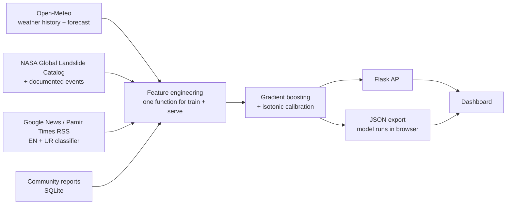

# KKH Road Status Predictor

**Will the Karakoram Highway be open tomorrow?** A segment-by-segment forecast for the
805 km of the KKH (N-35) from Havelian to the Khunjerab Pass. It combines weather
forecasts, landslide history and news / community road reports to give a probability
of a blockage on each segment for the next day.

Built for the travellers, drivers, transporters and tourists who depend on the KKH, where one
rockslide at Tatta Pani or Lotar can strand thousands of people.

<p>


</p>

---

## What it does

| Feature | |
|---|---|
| **Tomorrow's risk per segment** | 8 operational segments (Havelian→Besham … Sost→Khunjerab) with calibrated probabilities and Open / Delays possible / Likely blocked bands |
| **Why this number** | Every forecast explains what is driving it: tomorrow's rain/snow, recent rain, freeze-thaw, glacier melt, news reports, landslide history, season |
| **What-if simulator** | Move sliders for rain, snow, temperature and reports. The *same trained model* re-runs in the browser (trees exported to JSON, verified identical to Python) |
| **Trip planner** | Pick start and end (e.g. Havelian → Gilgit) and get the chance of getting through without a blockage |
| **Time machine** | Replay any evening since 2015: what the model would have said and what actually happened (hits and misses shown honestly) |
| **Community reports** | Drivers and locals report "blocked / one-way / open". Reports feed straight into the next forecast as a news signal (rate-limited) |
| **Living hero photo** | A real photo of the KKH below the Passu Cones: the painted centre-line is removed and redrawn in the photo's perspective so the road rolls by; rain, snow and mist follow the selected segment's forecast, and traffic slows as risk rises |
| **Bilingual** | Segment names and risk labels in English and Urdu, like Pakistani road signs |
| **Prediction log** | Every live forecast is stored, so real-world accuracy can be measured against what actually happened |

## How it works



**The question the model answers:** *with everything known on the evening of day t, will
segment s be blocked on day t+1?*

**Features (37)**, grouped:
- **Tomorrow's forecast:** rain, snow, rain hours, wind, storm total
- **Antecedent rain:** 3/7/14/30-day totals (wet slopes fail faster)
- **Snow and freeze-thaw:** frost cycles that crack rock faces
- **Heat and glacier melt:** temperature above a lapse-rate-adjusted threshold on glacier-fed segments (Hunza, Gojal, Khunjerab)
- **News and reports:** blocked/open reports per segment, decayed "net status", days since last report
- **Landslide history:** events in the last 90/365 days (with a 7-day reporting lag)
- **Season and segment:** cyclical day-of-year, monsoon flag, elevation, susceptibility

**Design decisions:**
- **Time-based split.** Train 2015–2022, calibrate on 2023, test on 2024–2026. A random split would leak tomorrow's storm into training.
- **Forecast-noise augmentation.** Training rows use the weather that actually happened on t+1, but live inputs are forecasts. Training adds realistic forecast error (±45% rain, missed showers, ±1.5 °C) so the model doesn't over-trust the forecast.
- **Calibration matters more than accuracy.** A traveller acts on "30%", so 30% has to mean 30%. Platt (sigmoid) calibration on a held-out year.
- **Physics as constraints.** More rain, snow, melt, reports or recent slides can never lower the risk: monotonic constraints in the gradient boosting.
- **Rules where rules are true.** The Pak-China border at Khunjerab is closed every winter (Dec–Mar). That's a schedule, not a prediction.
- **No train/serve skew.** `kkh/features.py::build_features` is the only feature code, used for both training and live prediction.

## Results

Test period 2024-01-01 → 2026-10-18 (7,844 segment-days the model never saw):

| | ROC-AUC | PR-AUC | Brier | Blockages caught at ≥20% | Right when it warns |
|---|---|---|---|---|---|
| **This model** | **0.944** | **0.347** | **0.0187** | **47%** | **37%** |
| Logistic regression | 0.928 | 0.332 | 0.0193 | 40% | 38% |
| Season only | 0.717 | 0.06 | 0.0234 | 0% | 0% |

Blockages happen on ~2.4% of segment-days, so PR-AUC 0.35 is about 14× better than chance.
Calibration (model said → happened): 7% → 7%, 14% → 17%, 27% → 31%, 41% → 42%, 58% → 51%.

> ⚠️ **Read these numbers carefully.** The data sources (Open-Meteo, NASA) were not reachable from
> the build environment, so this version was trained on the **bootstrap dataset**
> (`kkh/data/simulate.py`): simulated weather and closures calibrated to documented KKH patterns
> (monsoon peaks, Feb–Apr rain-on-snow, Dasu–Chilas as the most-blocked stretch, the Khunjerab
> winter closure). The scores show that the pipeline works end to end. They are **not** real-world
> accuracy. Run `python -m kkh.dataset --mode real` with internet access to rebuild on real data;
> the monthly `retrain.yml` workflow does this automatically and opens a PR with the new metrics.

## Model audit

`python scripts/audit_model.py` runs eight checks and writes `models/audit.json`. The first audit found three real bugs, all fixed and now guarded by tests:

| Finding | Effect | Fix |
|---|---|---|
| More rain in the last 7 days **lowered** risk on up to 27% of Dasu–Chilas days (by up to 30 points) | Physically wrong answers in the what-if tool and on wet weeks | Monotonic constraints on all physical drivers; `test_monotone_in_physical_drivers` |
| Isotonic calibration collapsed predictions onto 58 steps (only 76 blockages in the calibration year) | Many segments showed identical %, PR-AUC fell from 0.345 to 0.327 | Platt (sigmoid) calibration: same AUC, smooth probabilities |
| Time machine built "days since last report" from 45 days of context; training used full history | Replay features differed from training by up to 14 days | 95-day replay window, 92-day live window; `test_replay_features_match_training` |

What the audit confirmed:
- Data: no gaps, duplicates or impossible values.
- Rolling backtest, training only on earlier years: ROC-AUC 0.92 ± 0.04 across 2019–2026.
- Replay is only slightly optimistic vs a realistic forecast (PR-AUC 0.364 vs 0.347).
- The "whole road stays clear" chance is well calibrated overall (84% predicted vs 84.3% observed), a little pessimistic between 50 and 70%.

Known weak spot: blockages already being reported are caught 72% of the time, but **brand-new** blockages with no report yet only 35%. Havelian→Besham and Jaglot→Gilgit have too few events to learn from. Accidents are unpredictable from weather.

## Switch to real data (one click)

Windows: double-click **`GET_REAL_DATA.bat`**. macOS/Linux: `./get_real_data.sh`.
It creates a private Python environment, downloads Open-Meteo weather (2015 onward), the NASA
landslide catalog, the GDELT news archive of KKH closures (2017 onward), OpenStreetMap and photos,
rebuilds the dataset in real mode, retrains, audits, runs the tests and packs `real_data_bundle.zip`.
Takes about 45 minutes, mostly the news archive. The dashboard badge switches from
"Simulated data" to "Real data" automatically.

## Run it locally

```bash
git clone <your-repo-url> kkh-road-predictor && cd kkh-road-predictor
python -m venv .venv && source .venv/bin/activate      # Windows: .venv\Scripts\activate
pip install -r requirements-dev.txt

python -m kkh.dataset --mode auto    # real data if reachable, else bootstrap  (~1–2 min)
python -m kkh.model                  # train + evaluate -> models/
python -m pytest -q                  # 29 tests
flask --app app.main run             # http://127.0.0.1:5000
```

A trained model and processed data are committed, so `flask --app app.main run` works straight
after `pip install`.

## Deploy

**Render (full app with live forecasts):** push to GitHub, then on render.com choose
*New → Blueprint* and pick the repo. `render.yaml` builds the Dockerfile and wires up the health
check. Free plan works; community reports reset on redeploy unless you add a disk at `/app/var`.

**Hugging Face Spaces:** create a *Docker* Space, push this repo, and set the app port to 8000.

**Any Docker host:**
```bash
docker build -t kkh-road-status --build-arg RETRAIN=1 .   # RETRAIN=1 rebuilds on real data
docker run -p 8000:8000 kkh-road-status
```

**Static demo (GitHub Pages):** `python scripts/build_static.py` builds `dist/index.html`, a
single file with the model, time-machine replays and what-if tool embedded. CI publishes it to
GitHub Pages on every push to `main` (enable Pages → *GitHub Actions* in repo settings).

## API

| Method | Path | |
|---|---|---|
| GET | `/api/predict` | Live forecast for tomorrow (cached 30 min; falls back to stored data if offline and says so) |
| GET | `/api/predict?date=YYYY-MM-DD` | Time-machine replay of a past evening, with actual outcomes |
| GET | `/api/scenarios` | Past storm days for the replay |
| GET | `/api/segments` | Segment metadata + elevation profile |
| GET | `/api/route.geojson` | Route polylines per segment |
| GET | `/api/model` | Model card: metrics, calibration, drivers |
| GET | `/api/model_export.json` | Trained trees as JSON |
| GET / POST | `/api/reports` | Community reports (last 48 h) / add one `{segment_id, status, place?, note?}` |
| GET | `/api/health` | Health check |

## Project layout

```
kkh/
  config.py          segments, gazetteer, elevation profile, risk bands
  data/weather.py    Open-Meteo history + live forecast
  data/news.py       RSS fetch + English/Urdu blocked/open classifier + place->segment mapping
  data/landslides.py NASA catalogue + documented events -> per-segment history
  data/labels.py     daily blocked/open labels from news
  data/simulate.py   bootstrap dataset (offline fallback)
  dataset.py         step 2 orchestrator -> data/processed/
  features.py        feature engineering (train = serve)
  model.py           training, calibration, evaluation, browser export
  predict.py         live + replay prediction engine
  store.py           SQLite: community reports + prediction log
app/                 Flask app, dashboard (templates/, static/)
scripts/build_static.py   single-file static demo
scripts/audit_model.py    eight-check model audit
scripts/build_hero.py     prepares the hero photo (removes painted lane dashes so fx.js can animate them)
tests/               29 tests: leakage, monotonicity, train/serve skew, export parity, API, rate limit
```

## Limitations and next steps

- **Real labels are the bottleneck.** There is no official day-by-day KKH closure dataset. The
  news-derived labels miss unreported closures and the exact reopening time. Partnering with NHA
  or GB Police, or scraping their official social media updates, would improve labels the most.
- Weather comes from ~9–11 km model grids; local cloudbursts in narrow gorges are under-resolved.
- The trip planner treats segments as independent. Real storms hit neighbouring segments together,
  so the true "whole trip clear" chance is somewhat higher than shown.
- Next: GLOF early-warning signals for Shishper/Hassanabad, hourly nowcasts, SMS alerts in Urdu.

**Disclaimer:** forecasts are probabilities, not road orders. Always check with NHA (helpline 130)
or local police before travelling.

---
Built by **Qamar Abbas**, BS Economics & Data Science, Skardu, Gilgit-Baltistan.
